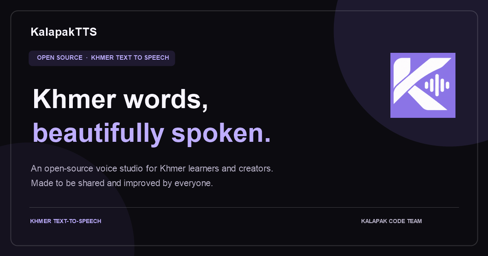

# KalapakTTS

**An open-source Khmer text-to-speech studio for learners and creators.**

KalapakTTS is a responsive web frontend for writing Khmer text and exploring a text-to-speech studio experience. It is built with Next.js, React, TypeScript, and Tailwind CSS.



## Project status

This repository currently contains the **frontend only**. The studio interface is a visual prototype: it does not generate or play real speech, connect to a speech API, or save generation history yet. The generation and preview controls explain when a backend connection is required.

The Windows download link is a placeholder for the studio. macOS and Linux are marked as coming soon.

## Features

- Khmer-focused text-to-speech studio interface
- English and Khmer language selector
- Light, dark, and system theme options
- Voice preset selection with speaking pace and inference quality controls
- Responsive navigation and page sections for the studio, voices, features, About, and downloads
- KalapakTTS favicon and branded Open Graph/Twitter sharing cards

## Technology

- [Next.js](https://nextjs.org/) App Router
- [React](https://react.dev/)
- [TypeScript](https://www.typescriptlang.org/)
- [Tailwind CSS](https://tailwindcss.com/)
- [Lucide](https://lucide.dev/) icons
- [flag-icons](https://github.com/lipis/flag-icons) language flags

## Requirements

- Node.js 20.9 or later
- npm

## Run locally

From the project root:

```bash
npm ci
npm run dev
```

Open [http://localhost:3000](http://localhost:3000).

## Available scripts

| Command | Description |
| --- | --- |
| `npm run dev` | Start the local development server |
| `npm run lint` | Run ESLint |
| `npm run build` | Create a production build |
| `npm run start` | Serve the production build |

To check a production build locally:

```bash
npm run build
npm run start
```

## Social sharing preview

The project includes branded preview images for Open Graph and Twitter-compatible large-image cards:

- `app/opengraph-image.png`
- `app/twitter-image.png`

For a custom production domain, set `NEXT_PUBLIC_SITE_URL` to the public site URL when building or deploying. For example, create a local `.env.local` file:

```env
NEXT_PUBLIC_SITE_URL=https://your-domain.example
```

On Vercel, `VERCEL_URL` is used as a fallback when `NEXT_PUBLIC_SITE_URL` is not set. Social networks need to be able to access the deployed site and its preview image; they cannot fetch previews from `localhost`. Some platforms cache previews, so a change may not appear immediately after deployment.

## Project structure

```text
app/
  globals.css          Global styles and theme adjustments
  icon.png             KalapakTTS favicon
  layout.tsx           Root layout and page/social metadata
  opengraph-image.png  Social sharing image
  page.tsx             Main page and interactive frontend
  twitter-image.png    Twitter-compatible sharing image
public/
  kalapaktts-logo-black.png
  kalapaktts-logo-white.png
```

## Contributing

Contributions and suggestions are welcome. For changes, please run `npm run lint` and `npm run build` before opening a pull request.

## License

No license file is included yet. Add a `LICENSE` file before publishing if you want to specify how others may use, modify, and distribute this project.
